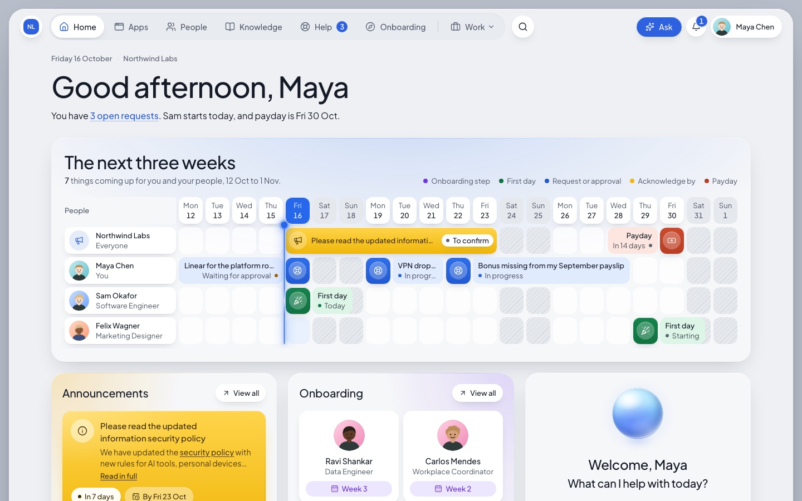
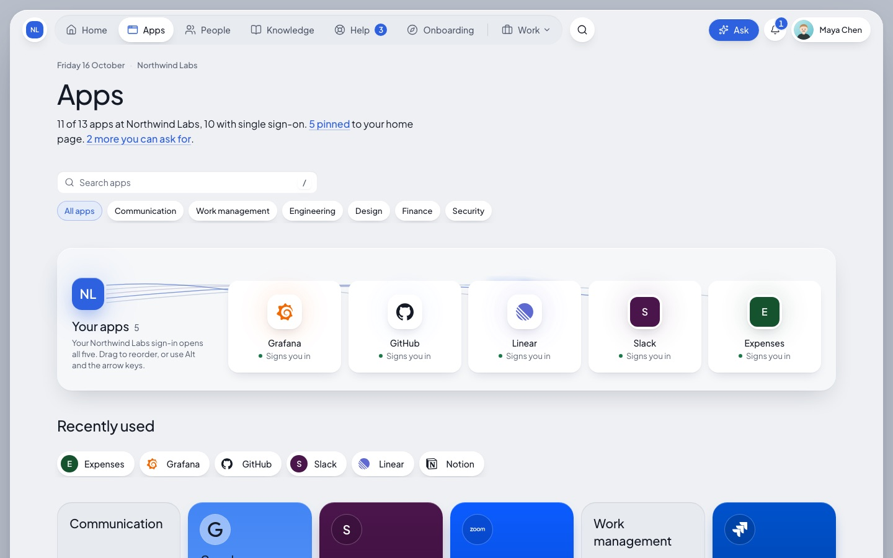
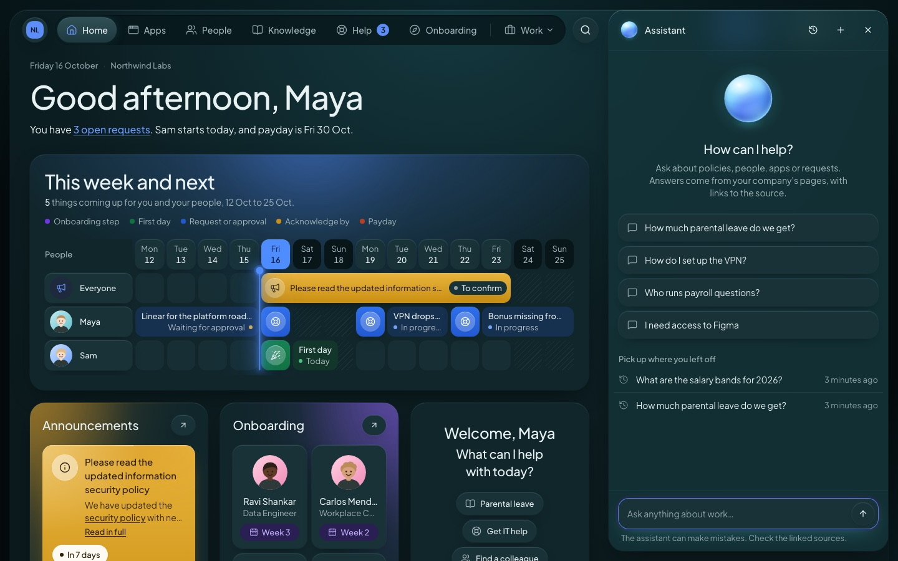
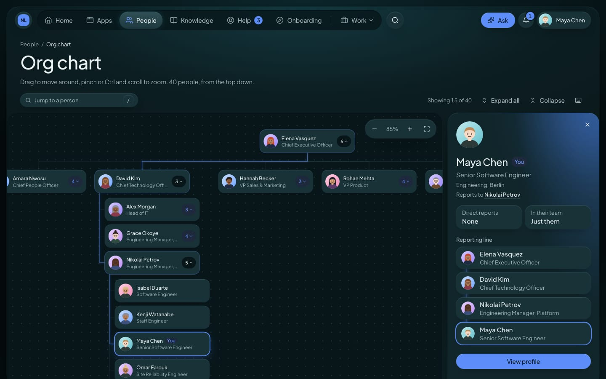
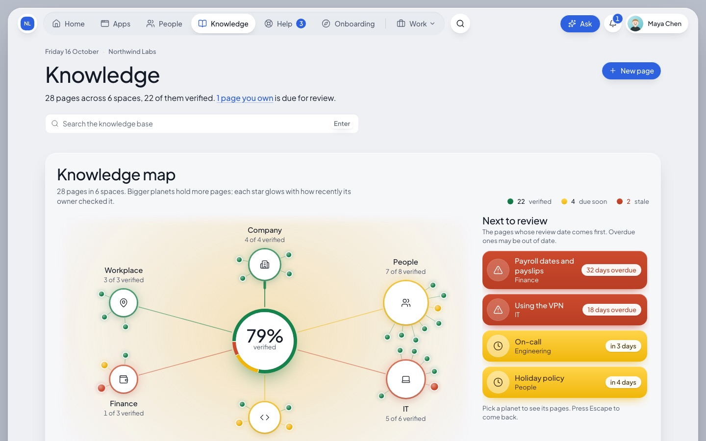
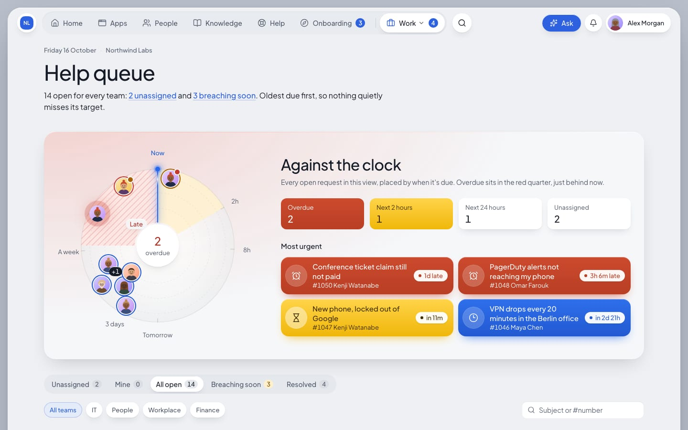
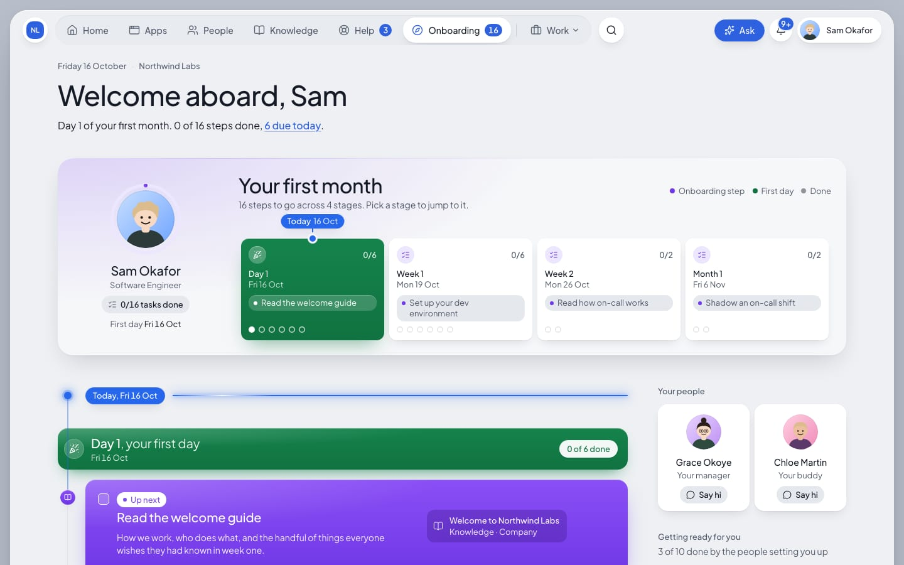
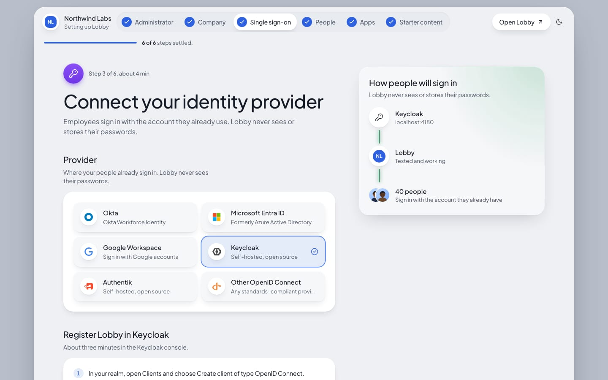

# Lobby

**The front door for your company.**
Lobby is an open-source, self-hosted intranet.
Every employee signs in once and finds the apps they use, the people they work with, the answers they need and the help they are waiting on, all in one place.

You run it on your own server with one `docker compose up` and a 10-minute setup wizard.
People sign in through the identity provider you already have, and Lobby never stores their passwords.



## Why Lobby

- **Live in an afternoon, not a quarter.** Commercial intranets often take months to roll out. Lobby is one Compose file and a guided setup.
- **Single sign-on is not a paid tier.** OIDC sign-in, SCIM provisioning and group-based roles are in the box, because an intranet whose job is "sign in once" should not charge extra for it.
- **Content that does not rot.** Every page has an owner and a review date. Stale pages are flagged, ranked lower in search and kept out of AI answers.
- **AI that respects permissions.** The assistant answers only from what the person asking is allowed to see, cites its sources, and says "I don't know" rather than guessing.
- **Yours to change.** MIT licensed, plain TypeScript and Postgres, no vendor services required.

## Features

| | |
|---|---|
| **App launcher with SSO.** Every app someone can use, one click away, signed in silently through your identity provider. People can request access to the apps they cannot see yet. |  |
| **AI assistant.** Ask about policies, people, apps or your requests. Answers come from your company's pages, with links to the sources. Actions such as raising a ticket always ask first. |  |
| **People and org chart.** A directory kept in sync by SCIM or CSV, an interactive org chart, profiles with skills and working hours, and a "Say hi" for new joiners. |  |
| **Knowledge with freshness.** Spaces and pages with group permissions, version history, review dates and a content-health view for owners. |  |
| **Helpdesk with SLAs and approvals.** A request catalog for IT, People, Workplace and Finance, with routing, business-hours response targets, manager or team approvals, and a Jira Service Management connector. |  |
| **Onboarding journeys.** A first-month plan that starts before day one: pages to read, policies to acknowledge, tickets raised for laptops and accounts, and steps for the manager and buddy. |  |
| **Setup wizard and admin.** Branding, identity provider with a live sign-in test, people, apps and starter content. Export and import the whole configuration as one YAML file. |  |

Also included: global search with a command palette (`Ctrl K` / `⌘ K`), targeted announcements with read receipts, news posts, in-app and email notifications, an audit log, and a designed dark theme.

## Try the demo

You need Docker with Compose 2.24 or newer.
The demo runs a fictional company, Northwind Labs, with its own identity provider (Keycloak), two single-sign-on apps (Grafana and an Expenses app) and 40 people.

```sh
git clone https://github.com/akshaymhetre/lobby.git
cd lobby
./deploy/setup.sh --demo
cd deploy && docker compose up -d
```

Then open http://localhost:4100 and sign in as `maya.chen` with the password `northwind`.
The first start builds the images, which takes a few minutes.

Other people worth signing in as:

| User | Sees Lobby as |
|---|---|
| `maya.chen` | An engineer: home, apps, requests, the assistant |
| `nikolai.petrov` | Maya's manager, who approves her requests |
| `alex.morgan` | Head of IT: administrator and IT helpdesk agent |
| `grace.okoye` | A manager following a new starter's onboarding |
| `sam.okafor` | A new hire who starts tomorrow |

All demo users share the password `northwind`.
The guided tour is in [docs/demo.md](docs/demo.md).

## Install for your company

The short version, on a Linux machine with Docker and a domain pointing at it:

```sh
git clone https://github.com/akshaymhetre/lobby.git
cd lobby
./deploy/setup.sh --blank --url https://lobby.example.com
cd deploy && docker compose up -d
```

Then open `https://lobby.example.com` straight away and complete the setup wizard.
Caddy fetches the HTTPS certificate for you.

The full guide covers requirements, DNS, running behind your own proxy, backups, restores and upgrades: [docs/install.md](docs/install.md).

### Connect your identity provider

Lobby works with any OpenID Connect provider.
Step-by-step guides:

- [Okta](docs/identity/okta.md)
- [Microsoft Entra ID](docs/identity/entra-id.md)
- [Google Workspace](docs/identity/google-workspace.md)
- [Keycloak](docs/identity/keycloak.md)
- [authentik](docs/identity/authentik.md)

### Configure it

Environment variables, using your own Postgres, configuration as code, roles and the AI assistant are covered in [docs/configuration.md](docs/configuration.md).
The AI assistant needs an Anthropic API key; everything else works without one.

## How it is built

| Layer | Choice |
|---|---|
| Web app | Next.js 16 (App Router, React Server Components), React 19, Tailwind CSS 4, Motion |
| Background jobs | A separate worker on pg-boss: SLA timers, journeys, search indexing, connectors |
| Data | PostgreSQL 17 with pgvector, Drizzle ORM and migrations |
| Search | Postgres full-text and vector search, merged by reciprocal rank fusion, with permissions applied inside the query |
| Sign-in | OpenID Connect relying party (openid-client), SCIM 2.0 provisioning |
| AI | Claude through the Anthropic SDK, behind a small provider interface |
| Deploy | Docker Compose with Caddy for HTTPS |

More detail, including the repository layout and conventions, is in [docs/architecture.md](docs/architecture.md).

## Develop Lobby

You need Node 24, pnpm 11 and Docker.

```sh
cd deploy && docker compose --profile demo-idp --profile demo-apps up -d && cd ..
pnpm install
pnpm db:reset
pnpm --filter @lobby/web dev        # http://localhost:4100
pnpm --filter @lobby/worker dev
```

Development runs the app on your machine and only Postgres and the demo services in Docker.

Checks:

```sh
pnpm check     # typecheck, lint and unit tests across the workspace
pnpm e2e       # Playwright end-to-end tests against the running app
```

See [CONTRIBUTING.md](CONTRIBUTING.md) before opening a pull request.

## Status

Lobby is young.
It is a complete, working product you can run today, but it has not yet been battle-tested in large production deployments.
SAML sign-in, a Helm chart, Slack and Teams intake, and more helpdesk connectors are on the list.
Issues and pull requests are welcome.

## Licence

[MIT](LICENSE).
